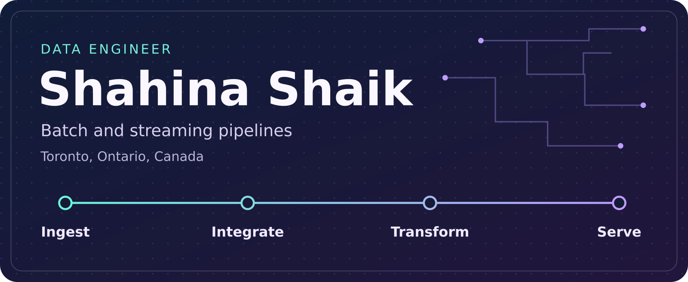

[Pipeline walkthrough](#pipeline-walkthrough) · [Engineering toolbox](#engineering-toolbox) · [Explore repositories](https://github.com/shahinashiny?tab=repositories)

<!-- Restore the LinkedIn, portfolio, and email links from the current profile README here before publishing. -->

## Pipeline walkthrough

**Shahina Shaik · Data Engineer at Lyft · August 2026–Present**

I build ETL/ELT pipelines and cloud datasets for analytics and machine learning. Over 4 years in data engineering, I’ve worked across batch and streaming workflows, from validating source data to tuning downstream queries.

> **90 min → 65 min** processing time after orchestrating dependencies, incremental loads, and scheduled Amazon S3 refreshes with Apache Airflow.

| Stage | What happens to the data | Tools |
| --- | --- | --- |
| **Ingest** | Transaction and payment events enter a streaming pipeline. | Kafka · PySpark |
| **Integrate** | Transaction histories, customer profiles, and payment gateway records are combined. | AWS Glue · Snowflake |
| **Transform** | Raw records become features such as transaction frequency and spending velocity. | Python · SQL |
| **Serve** | Prepared datasets support fraud risk analysis and model training. | Snowflake |

## Engineering toolbox

| **Build** | **Run** | **Improve** |
| --- | --- | --- |
| Python · SQL · PySpark | Kafka · Airflow | Data validation |
| AWS Glue · Snowflake | Amazon S3 · Incremental loads | Query optimization · Pipeline troubleshooting |

## Explore my work

[Browse my GitHub repositories →](https://github.com/shahinashiny?tab=repositories)

<!-- Add selected project links and any additional experience from your current README here. -->
